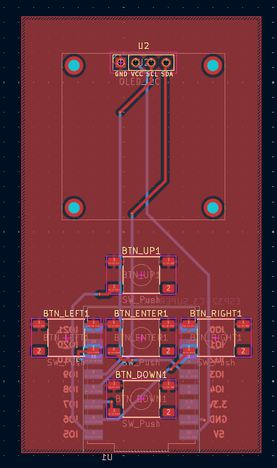
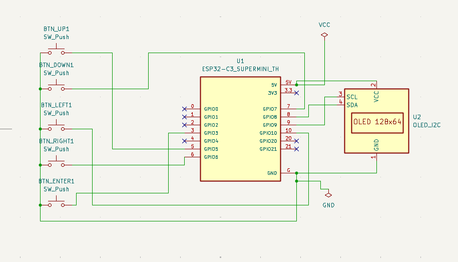

# gAssist (WIP)

### gAssist is a portable device, which connects to your phone and gives you the most important information. It includes functions as:

* Reading notifications from smartphone
* Taking pictures from the smartphone using gAssist (Remote Camera Shutter)
* Controlling media, running on the phone (Media Controller with previous track, play/pause and next track)
* Controlling presentations (Presentation controller with Previous slide, next slide, start and end slideshow)
* Control volume (Volume Control)
* ...more in future versions

## Description
 - gAssist is an ESP32-C3 based device, utilising a 0.96inch SSD1306 OLED display for displaying menus and information. It is controlled using 5 push buttons (up, down, left, right and enter) which control menus on the display. You can use it to read your notifications, without touching your phone (This option is currently only supported on iOS); Control running media by using the Media Control menu, take photos without the need of running back to your phone using the Remote Camera shutter.
 - More functionalities are planned to be implemented.
 - It will have a 3D printed enclosure which is going to be portable and small, so you can hide it in your pocket.

## BOM (Bill of Materials)
 - 1pcs ESP32-C3-Super-Mini (Other ESP32s could be used probably, but I haven't tested yet)
 - 1 pcs SSD1306 0.96inch OLED display
 - 5pcs push-buttons
 - 1 pcs custom PCB or breadboard

## Short build guide
 - You can use the schematic below to connect the parts together on a breadboard
 - You can also use the PCB provided or create your own PCB
 - The program is coded using the Arduino framework in Platform.IO
 - All the libraries required are written in platformio.ini
 - ESP32-ANCS library is modified for the use of this project and is provided as a ZIP in the repo

## Planned implementations
 - Notifications on Android
 - Lock/Unlock switch
 - BLE connection manager (Control paired devices and switch connected device)

## Screenshots of the project

### PCB design

### Schematic

## Demo of the project

### Overview of menus
* https://youtu.be/tBosUBp-U7k
   
### Overview of notifcation menu
*  https://youtu.be/h5D4cYwPhq4

### Demo of media control
* https://youtu.be/3CNltpzKNEg

### Demo of remote camera shutter
* https://youtu.be/_CQfvp7ikwA

### Overview of new functionalities added to gAssist (Volume control and Presentation Control)
* https://youtu.be/w5ZUXPo0fjg

### Demo of presentation control on gAssist
* https://youtu.be/Z9RXJxisC2w

### Compiled binary of latest working version 
* https://github.com/PetrovGD/gAssist/releases/download/releases/firmware.bin

## The enclosure of gAssist is still unfinished so it's not uploaded here. 

